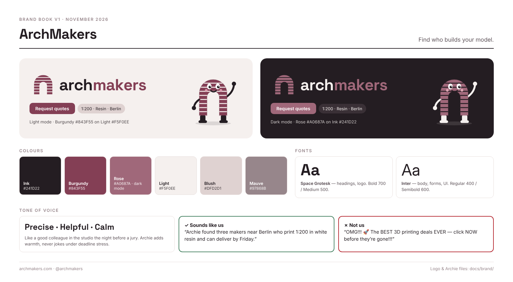

# ArchMakers

**A website where architects find 3D printing, laser-cutting and model-making companies that do architecture work, and request quotes from up to five of them with one form.**

Project by **Leonita Ajdari**, Rapid AI Development course (weekend 1: idea, business and brand, before any code).

## Docs

| File | Contents |
|---|---|
| [`docs/business.md`](docs/business.md) | Parts 1–4: problem, big picture, market, business model and price |
| [`docs/brand-book.md`](docs/brand-book.md) | Part 5: name, tagline, logo, colours, fonts, tone of voice, Archie the mascot |
| [`docs/brand/`](docs/brand/) | Logo files, Archie, one-page brand sheet |
| [`docs/rules-and-flows.md`](docs/rules-and-flows.md) | Part 6: users and roles, main flows, business rules, what v1 will not do |

## Credits

The idea came from conversations with my cousin, an architect in Germany. The business decisions are mine. The docs, logo and brand sheet were drafted with help from Claude (AI) and then reviewed and edited by me.
