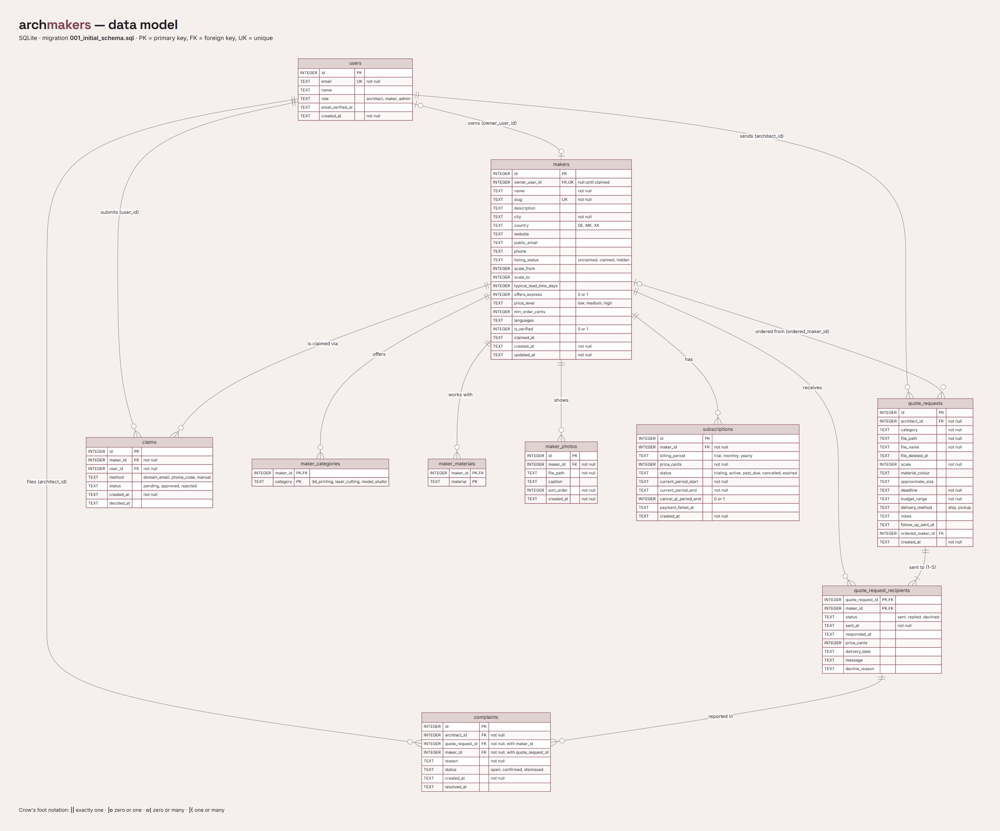

# Data model — ArchMakers v1

Weekend 2, part 4. This page describes the SQLite database created by the first migration, [`server/src/db/migrations/001_initial_schema.sql`](../server/src/db/migrations/001_initial_schema.sql). Every table and field comes from the users, flows and business rules in [`rules-and-flows.md`](rules-and-flows.md) and [`business.md`](business.md).

## 1. Introduction

ArchMakers connects **architects** with **makers** (3D print shops, laser-cutting shops and model-making studios). The data follows the three main flows:

- **Flow A:** an architect sends one **quote request** to up to 5 **makers**, and each maker replies or declines.
- **Flow B:** a maker **claims** a listing and edits its details, photos, categories and materials.
- **Flow C:** a maker has a **Pro subscription** (3-month trial, then monthly or yearly).

ArchMakers never handles payments between architects and makers (rule 11), so there are no orders, payments or invoices between them in the database.

**Conventions used in every table**

| What | How it's stored |
|---|---|
| Table type | `STRICT`: SQLite rejects values of the wrong type |
| Primary keys | `id INTEGER PRIMARY KEY`, except junction tables, which use a composite key |
| Dates and times | `TEXT` in ISO 8601, UTC (e.g. `2026-11-17 18:00:00`); `created_at` defaults to `datetime('now')` |
| True / false | `INTEGER` 0 or 1 |
| Money | `INTEGER` in euro cents (e.g. €29 = `2900`) |
| Scales | `INTEGER` denominator (e.g. 1:200 = `200`) |
| Fixed lists | `TEXT` with a `CHECK (... IN (...))` constraint |
| Foreign keys | Enforced: the app runs `PRAGMA foreign_keys = ON` on every connection (`server/src/config/database.js`) |

## 2. The data models

| # | Table | Purpose | Doc source |
|---|---|---|---|
| 1 | `users` | Everyone with an account: architects, makers and admins | Roles table |
| 2 | `makers` | A company listing: unclaimed, claimed or hidden | Roles, Flow B, rules 8–9 |
| 3 | `maker_categories` | Which categories a maker offers (3D printing, laser cutting, model studio) | Flow A step 1, Flow B step 4 |
| 4 | `maker_materials` | Materials a maker works with, used for filtering | Flow A step 2, Flow B step 4 |
| 5 | `maker_photos` | Photos of real architecture models | Flow B step 4, Free/Pro limits |
| 6 | `quote_requests` | One request from an architect, with file, scale, deadline and budget | Flow A, rules 2–3, 10 |
| 7 | `quote_request_recipients` | Which makers got a request, and each maker's reply or decline | Flow A steps 4 and 9, Flow B step 6, rules 4–6 |
| 8 | `claims` | A user proving a listing is their company | Flow B steps 2–3 |
| 9 | `subscriptions` | A maker's Pro trial and paid periods | Flow C, rule 12 |
| 10 | `complaints` | An architect reporting a maker after a reply | Rule 13 |

The migration runner also creates a small helper table, `schema_migrations`, which records which migrations have run (see section 6).

**Not stored, because the app calculates them from the tables above:**
- the **response rate** (replies and declines within 48 h over 90 days), from `quote_request_recipients`
- whether a maker is on **Free or Pro**, from `subscriptions`
- the number of **requests a Free maker received this month**, from `quote_request_recipients`

**Left out on purpose:**
- **login tokens:** authentication isn't part of this assignment
- **page-view stats and "missed requests" counts for Pro:** added when that feature is built
- **public star reviews:** v1 has none, see section 4 of `rules-and-flows.md`

## 3. Fields and data types

Legend:
- **PK** primary key
- **FK** foreign key
- **UQ** unique
- **Req** required (`NOT NULL`)

### `users`

| Field | Type | Key | Req | Notes |
|---|---|---|:-:|---|
| `id` | INTEGER | PK | ✅ | |
| `email` | TEXT | UQ | ✅ | Login is by email; unique ignoring upper/lower case (`COLLATE NOCASE`) |
| `name` | TEXT | | | |
| `role` | TEXT | | ✅ | `architect`, `maker` or `admin` |
| `email_verified_at` | TEXT | | | Set when the one-time link is confirmed |
| `created_at` | TEXT | | ✅ | Default `now` |

### `makers`

| Field | Type | Key | Req | Notes |
|---|---|---|:-:|---|
| `id` | INTEGER | PK | ✅ | |
| `owner_user_id` | INTEGER | FK → `users.id`, UQ | | Empty while unclaimed. On user delete: set to empty |
| `name` | TEXT | | ✅ | Company name |
| `slug` | TEXT | UQ | ✅ | Used in the maker page URL |
| `description` | TEXT | | | |
| `city` | TEXT | | ✅ | Indexed for search |
| `country` | TEXT | | ✅ | `DE` (default), `MK` or `XK` |
| `website`, `public_email`, `phone` | TEXT | | | Public business information (rule 9); also used to check claims |
| `listing_status` | TEXT | | ✅ | `unclaimed` (default), `claimed` or `hidden` |
| `scale_from`, `scale_to` | INTEGER | | | Scale range, e.g. 50 and 1000 for 1:50–1:1000. `scale_from` ≤ `scale_to` |
| `typical_lead_time_days` | INTEGER | | | |
| `offers_express` | INTEGER | | ✅ | 0 or 1, default 0 |
| `price_level` | TEXT | | | `low`, `medium` or `high` |
| `min_order_cents` | INTEGER | | | Minimum order value, used for matching (rule 5) |
| `languages` | TEXT | | | e.g. `de,en` |
| `is_verified` | INTEGER | | ✅ | 0 or 1, the Verified badge (rule 8) |
| `claimed_at` | TEXT | | | |
| `created_at`, `updated_at` | TEXT | | ✅ | Default `now` |

### `maker_categories`

| Field | Type | Key | Req | Notes |
|---|---|---|:-:|---|
| `maker_id` | INTEGER | PK, FK → `makers.id` | ✅ | On maker delete: cascade |
| `category` | TEXT | PK | ✅ | `3d_printing`, `laser_cutting` or `model_studio` |

### `maker_materials`

| Field | Type | Key | Req | Notes |
|---|---|---|:-:|---|
| `maker_id` | INTEGER | PK, FK → `makers.id` | ✅ | On maker delete: cascade |
| `material` | TEXT | PK | ✅ | e.g. `White resin`, `Greyboard` |

### `maker_photos`

| Field | Type | Key | Req | Notes |
|---|---|---|:-:|---|
| `id` | INTEGER | PK | ✅ | |
| `maker_id` | INTEGER | FK → `makers.id` | ✅ | On maker delete: cascade |
| `file_path` | TEXT | | ✅ | |
| `caption` | TEXT | | | |
| `sort_order` | INTEGER | | ✅ | Default 0 |
| `created_at` | TEXT | | ✅ | Default `now` |

The Free limit (3 photos) and the Pro limit (unlimited) are checked by the app.

### `quote_requests`

| Field | Type | Key | Req | Notes |
|---|---|---|:-:|---|
| `id` | INTEGER | PK | ✅ | |
| `architect_id` | INTEGER | FK → `users.id` | ✅ | On user delete: cascade |
| `category` | TEXT | | ✅ | Same three values as `maker_categories.category` |
| `file_path`, `file_name` | TEXT | | ✅ | The 3D file (STL, OBJ or 3MF), required by rule 2 |
| `file_deleted_at` | TEXT | | | Set when the file is deleted after 60 days (rule 10) |
| `scale` | INTEGER | | ✅ | e.g. 200 for 1:200, required by rule 2 |
| `material_colour` | TEXT | | | |
| `approximate_size` | TEXT | | | e.g. `40 × 40 cm` |
| `deadline` | TEXT | | ✅ | Date, at least 3 working days ahead (rule 3, checked by the app) |
| `budget_range` | TEXT | | ✅ | `under_100`, `100_250`, `250_500` or `over_500` |
| `delivery_method` | TEXT | | ✅ | `ship` (default) or `pickup` |
| `notes` | TEXT | | | |
| `follow_up_sent_at` | TEXT | | | The "Did you order?" email sent 7 days later |
| `ordered_maker_id` | INTEGER | FK → `makers.id` | | The architect's answer to the follow-up. On maker delete: set to empty |
| `created_at` | TEXT | | ✅ | Default `now` |

### `quote_request_recipients`

| Field | Type | Key | Req | Notes |
|---|---|---|:-:|---|
| `quote_request_id` | INTEGER | PK, FK → `quote_requests.id` | ✅ | On request delete: cascade |
| `maker_id` | INTEGER | PK, FK → `makers.id` | ✅ | On maker delete: cascade. Indexed for the maker's inbox |
| `status` | TEXT | | ✅ | `sent` (default), `replied` or `declined` |
| `sent_at` | TEXT | | ✅ | Default `now` |
| `responded_at` | TEXT | | | Used for the 48-hour response rate (rule 6) |
| `price_cents` | INTEGER | | | The maker's quote |
| `delivery_date` | TEXT | | | |
| `message` | TEXT | | | |
| `decline_reason` | TEXT | | | `too_busy`, `outside_scales`, `budget_too_low` or `other` |

The composite primary key means a maker can receive the same request only once. The "max 5 makers per request" and "max 10 requests per day" limits (rule 4) are checked by the app.

### `claims`

| Field | Type | Key | Req | Notes |
|---|---|---|:-:|---|
| `id` | INTEGER | PK | ✅ | |
| `maker_id` | INTEGER | FK → `makers.id` | ✅ | On maker delete: cascade |
| `user_id` | INTEGER | FK → `users.id` | ✅ | On user delete: cascade |
| `method` | TEXT | | ✅ | `domain_email`, `phone_code` or `manual` (admin check) |
| `status` | TEXT | | ✅ | `pending` (default), `approved` or `rejected` |
| `created_at` | TEXT | | ✅ | Default `now` |
| `decided_at` | TEXT | | | |

### `subscriptions`

| Field | Type | Key | Req | Notes |
|---|---|---|:-:|---|
| `id` | INTEGER | PK | ✅ | |
| `maker_id` | INTEGER | FK → `makers.id` | ✅ | On maker delete: cascade |
| `billing_period` | TEXT | | ✅ | `trial`, `monthly` or `yearly` |
| `price_cents` | INTEGER | | ✅ | Default 0 (trial). e.g. 2900 in Germany, 900 in MK/XK |
| `status` | TEXT | | ✅ | `trialing`, `active`, `past_due`, `cancelled` or `expired` |
| `current_period_start`, `current_period_end` | TEXT | | ✅ | |
| `cancel_at_period_end` | INTEGER | | ✅ | 0 or 1. Pro stays active until the period ends (Flow C step 5) |
| `payment_failed_at` | TEXT | | | Starts the 7-day grace period (Flow C step 6) |
| `created_at` | TEXT | | ✅ | Default `now` |

### `complaints`

| Field | Type | Key | Req | Notes |
|---|---|---|:-:|---|
| `id` | INTEGER | PK | ✅ | |
| `architect_id` | INTEGER | FK → `users.id` | ✅ | On user delete: cascade |
| `quote_request_id` + `maker_id` | INTEGER | FK → `quote_request_recipients` (both columns) | ✅ | A complaint is only possible about a maker who got that request. On delete: cascade |
| `reason` | TEXT | | ✅ | |
| `status` | TEXT | | ✅ | `open` (default), `confirmed` or `dismissed` |
| `created_at` | TEXT | | ✅ | Default `now` |
| `resolved_at` | TEXT | | | |

Confirmed complaints over 6 months are counted for rule 13.

## 4. Relationships

| Relationship | Type | How |
|---|---|---|
| `users` – `makers` | **One-to-one (optional)** | `makers.owner_user_id` is a `UNIQUE` FK: a user owns at most one listing, and a listing has at most one owner. It's empty while unclaimed |
| `quote_requests` – `makers` | **Many-to-many** | Junction table `quote_request_recipients`: one request goes to 1–5 makers, and a maker receives many requests |
| `users` → `quote_requests` | One-to-many | An architect sends many requests (`architect_id`) |
| `makers` → `maker_categories` | One-to-many | A maker offers one or more of the 3 categories |
| `makers` → `maker_materials` | One-to-many | A maker lists many materials |
| `makers` → `maker_photos` | One-to-many | A maker has many photos |
| `makers` → `claims` | One-to-many | A listing can have several claim attempts (e.g. one rejected, then one approved) |
| `users` → `claims` | One-to-many | The user who made each claim |
| `makers` → `subscriptions` | One-to-many | One row per period: trial, then monthly or yearly |
| `makers` → `quote_requests` (`ordered_maker_id`) | One-to-many (optional) | Which maker the architect ordered from, if they answered the follow-up |
| `quote_request_recipients` → `complaints` | One-to-many | Composite FK: a complaint is about one maker's handling of one request |
| `users` → `complaints` | One-to-many | The architect who reported it |

**What happens on delete:**
- Deleting a **maker** (e.g. a removal request, rule 9) removes its photos, categories, materials, claims, subscriptions and the requests it received. Old requests keep `ordered_maker_id` but set to empty.
- Deleting a **user** removes their requests, claims and complaints. A maker they owned becomes unclaimed (`owner_user_id` set to empty).

## 5. ER diagram



**Crow's foot notation:**
- `||` exactly one
- `|o` zero or one
- `o{` zero or many
- `|{` one or many

The diagram source is in [`data-model.dbml`](data-model.dbml), written in DBML for [dbdiagram.io](https://dbdiagram.io). To view it or export it again:
1. Open dbdiagram.io and click **Go to App**.
2. Paste the contents of `data-model.dbml` into the editor.
3. Click **Export → PNG** (or PDF/SVG).

## 6. First migration

| | |
|---|---|
| File | `server/src/db/migrations/001_initial_schema.sql` |
| Runner | `server/src/db/migrate.js` |
| Command | `npm run migrate` (in `server/`) |
| Database | `server/data/archmakers.db`, or the path in `DATABASE_PATH` |

**How it works:**
- The runner creates `schema_migrations` if needed, then runs every `NNN_name.sql` file in `migrations/` that isn't recorded there yet, in number order.
- Each file runs inside a transaction, so it is applied completely or not at all.
- After running, it does a `PRAGMA foreign_key_check`.
- Running it again is safe: it prints "Database is up to date" and changes nothing.
- It never deletes data or recreates the database.
- The migration inserts **no data**.

**Run it:**
```bash
cd server
npm install
npm run migrate
```

**Try it on a fresh, separate database (the file is created automatically):**
```bash
DATABASE_PATH=data/test.db npm run migrate
```

**Next changes:** add a new file such as `002_add_something.sql`. Never edit `001` after it has been applied.

**In Git:** the migration files are tracked. The database files (`*.db`, `*.db-journal`, `*.db-shm`, `*.db-wal`) are ignored by `.gitignore`.
